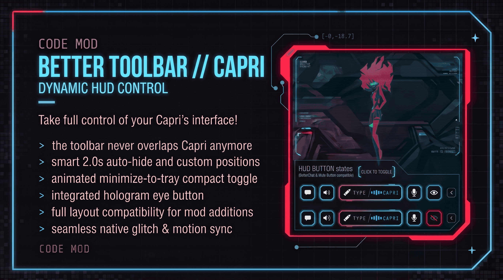

# Better Toolbar // Capri

Tired of the toolbar overlapping Capri or lingering on screen? Take full control over Capri's HUD layout and behavior!

- Kind: code mod
- Made by: CyberPhantxm

| Feature | Behavior |
|---|---|
| Non-Overlap Layout | Measures Capri's actual sprite bounds so the toolbar never overlaps Capri, the taskbar, or screen edges—shifting cleanly to the left or right when she is near the bottom of the screen. |
| Auto-Hide & Instant Dismiss | Automatically hides after **2.0s** (normal) or **1.5s** (Hologram mode) once the cursor leaves the toolbar, and dismisses immediately when clicking outside (closing the right-click menu as well). |
| Hologram Eye Button | Adds a native-styled eye button on the right side of the toolbar to toggle Hologram mode in one click, while keeping `TYPE`, `TALK`, and `MIC` fully interactive in Hologram mode. |
| Animated Minimize-to-Tray | Adds a compact tray handle that smoothly slides and collapses all toolbar buttons (including third-party mod buttons) into a discreet arrow, saving your preference automatically between sessions. |
| Exclusive `TYPE` Toggle | Click `TYPE` to open the input box and click `TYPE` again to close it, preventing unintentional closes when clicking other toolbar buttons. |
| Native Glitch Sync | Mirrors Capri's 4-frame glitch-in animation on the Hologram button, tray handle, and active toolbar mod buttons. |

**How to use:** Hover over Capri to bring up her toolbar—it automatically positions itself clear of her sprite, the taskbar, and screen edges. Click the eye icon on the right to toggle Hologram mode, click the compact arrow handle to smoothly collapse or expand the toolbar, or click `TYPE` to open and close the input box. Clicking anywhere outside dismisses the toolbar immediately.

- Compatibility: Better Chat // Capri (by: CyberPhantxm), Mute Button MOD (by: Potato)
